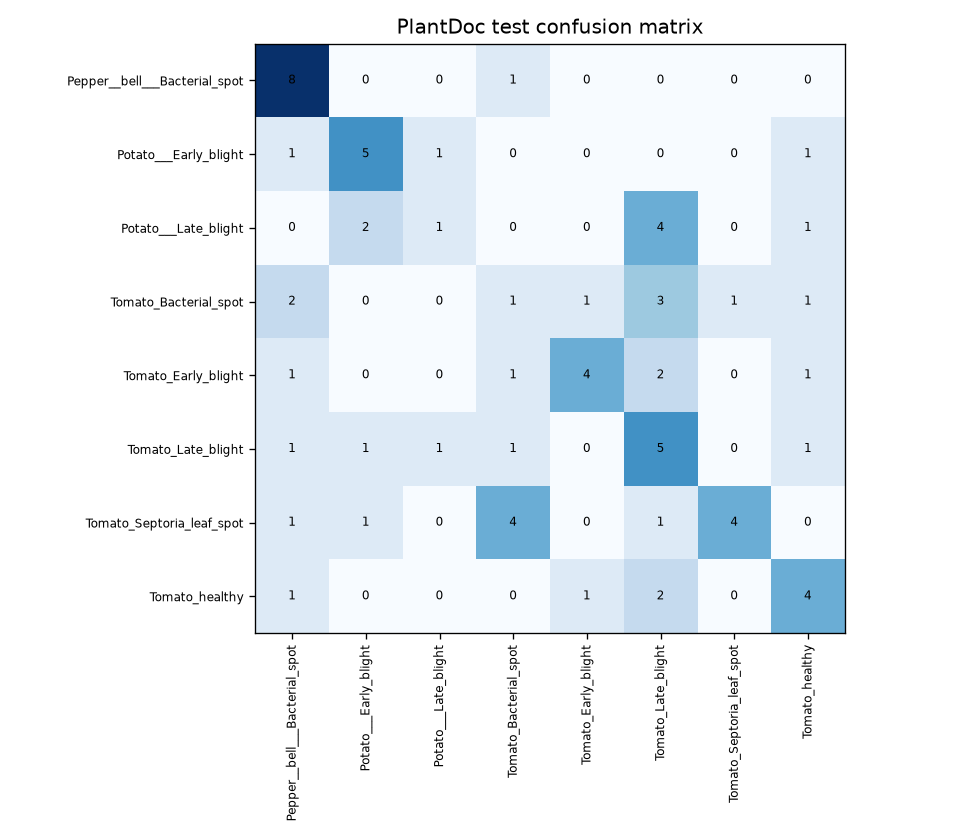

# Model card: AgroScan leaf disease classifier

## Model details

- **Task:** classify a single pepper, potato, or tomato leaf photo into one of eight disease/healthy classes.
- **Architecture:** MobileNetV2 with a Keras softmax classification head.
- **Selected baseline recorded by the pipeline:** v5 metadata at `models/model_meta.v5.json` identifies version/run `323d1ae1dc89405f9ba383baae3d944e`, MLflow registered model `agroscan-mobilenetv2`, model version `2`. It expects 288 × 288 RGB inputs, center-cropped and supplied as raw 0–255 values; its confidence threshold is 0.7 and it returns top three classes.
- **Candidate model:** the DVC pipeline trains at 224 × 224 with values scaled to [0, 1]. `reports/model_comparison.json` records candidate MLflow run `af8a4d72ce294efdb725b814e7d5c4dd`, registered version `1`, and shows it below the 0.50 PlantDoc gate. `reports/prepared_model_comparison.json` records the same candidate run and archive-cleaned comparisons.
- **Current serving confirmation:** `models/model_meta.json` and local `mlflow.db` are absent in this checkout, so the exact artifact currently loaded by a running service and the live registry record cannot be verified here. The recorded v5 metadata and model-comparison report identify v5 as the passing baseline, but do not prove that an active deployment loaded it. **TODO:** provide `models/model_meta.json` and the relevant MLflow tracking/registry record from the deployed environment to confirm the active version.
- **Owners/contact:** TODO: add team member names and a project contact.

## Intended use

AgroScan is a learning and decision-support demonstration that suggests likely classes from a photo. Its top-three candidates and low-confidence warning may help a user decide when to seek expert review.

It is not a substitute for an agronomist and must not be the sole basis for treatment, pesticide, crop-loss, insurance, or regulatory decisions. It only supports the eight classes below; it does not identify other crops, plant parts, pests, nutrient deficiencies, or unknown diseases.

## Data and evaluation protocol

The current DVC preparation stage uses PlantVillage and PlantDoc training images for train/validation, and reserves the PlantDoc test split for evaluation. The separate prepared archive reports also include PlantWild test images. PlantDoc should not be described as test-only across the repository: its train subset is in the training pool.

`reports/data_validation.json` reports valid prepared splits with 10,240 train images, 1,808 validation images, and 72 PlantDoc test images. Counts by class:

| Class | Train | Validation | PlantDoc test |
|---|---:|---:|---:|
| Pepper__bell___Bacterial_spot | 900 | 159 | 9 |
| Potato___Early_blight | 939 | 166 | 8 |
| Potato___Late_blight | 931 | 164 | 8 |
| Tomato_Bacterial_spot | 1,894 | 334 | 9 |
| Tomato_Early_blight | 917 | 162 | 9 |
| Tomato_Late_blight | 1,701 | 301 | 10 |
| Tomato_Septoria_leaf_spot | 1,564 | 276 | 11 |
| Tomato_healthy | 1,394 | 246 | 8 |
| **Total** | **10,240** | **1,808** | **72** |

The separate exact-duplicate audit in `reports/prepared_dataset_audit.json` found 46 exact-duplicate groups crossing splits, 42 of them with conflicting labels. Its archive cleaning policy excluded 2 of 72 PlantDoc test images (70 retained) and 5 of 304 PlantWild test images (299 retained). This prepared-archive audit is distinct from the current DVC manifests: `reports/prepared_model_comparison.json` says the pipeline training manifest had zero exact-hash overlaps with either archived test set, while `reports/data_validation.json` reports no duplicate issues for its current train/validation/test manifests. Do not combine the split counts from one evaluation with the scores from another.

## Performance

### Existing v5 baseline

The per-class table below is measured on the **cleaned 70-image PlantDoc prepared-archive test set**, from `reports/v5_plantdoc_prepared_metrics.json`. It is not the 72-image current DVC test set.

| Class | Precision | Recall | F1 | Support |
|---|---:|---:|---:|---:|
| Pepper__bell___Bacterial_spot | 0.800 | 0.889 | 0.842 | 9 |
| Potato___Early_blight | 0.750 | 0.375 | 0.500 | 8 |
| Potato___Late_blight | 0.500 | 0.625 | 0.556 | 8 |
| Tomato_Bacterial_spot | 0.250 | 0.250 | 0.250 | 8 |
| Tomato_Early_blight | 0.462 | 0.750 | 0.571 | 8 |
| Tomato_Late_blight | 0.750 | 0.600 | 0.667 | 10 |
| Tomato_Septoria_leaf_spot | 0.700 | 0.636 | 0.667 | 11 |
| Tomato_healthy | 0.857 | 0.750 | 0.800 | 8 |
| **macro avg** | 0.634 | 0.609 | 0.607 | 70 |
| **weighted avg** | 0.642 | 0.614 | 0.614 | 70 |

The saved confusion matrix below is for the **pipeline candidate on the 72-image current PlantDoc test split**, generated alongside `reports/classification_report.json`; it is not the v5 table above.

### Results reported by source file

| Model/report | Dataset and sample | Top-1 | Top-3 | Source |
|---|---|---:|---:|---|
| v5 | PlantDoc, 72 | 58.3% | 94.4% | `reports/v5_plantdoc_metrics.json` |
| v5 | Cleaned PlantDoc, 70 | 61.4% | 94.3% | `reports/v5_plantdoc_prepared_metrics.json` |
| v5 | Cleaned PlantWild, 299 | 60.5% | 89.0% | `reports/v5_plantwild_metrics.json` |
| v5 | PlantWild including duplicates, 304 | 60.9% | 88.8% | `reports/v5_plantwild_metrics_including_duplicates.json` |
| Pipeline candidate | Current PlantDoc test, 72 | 44.4% | not reported | `reports/metrics.json` (`test_accuracy`) |
| Pipeline candidate | Cleaned PlantDoc, 70 | 42.9% | 78.6% | `reports/pipeline_plantdoc_prepared_metrics.json` |
| Pipeline candidate | Cleaned PlantWild, 299 | 37.5% | 68.2% | `reports/pipeline_plantwild_prepared_metrics.json` |

The PlantDoc top-1 result previously attributed to a training notebook is absent from the committed report directory. **TODO:** provide the notebook output/source if that reported test result should be included. The previously cited PlantWild result is measured by the all-304 report above; the cleaned 299-image report records a different score. `reports/prepared_model_comparison.json` has notebook-reported validation values, not a notebook test result.

These test sets are small, particularly the 70–72-image PlantDoc evaluation. Results from the 70-image and 72-image manifests are not directly interchangeable. The validation/test gap and differences across archive-cleaning policies indicate domain and dataset variation; a few percentage points should not be over-interpreted.

## Explainability

LIME and SHAP notebooks exist at `notebooks/lime_example.ipynb` and `notebooks/shap_example.ipynb`, but `reports/explainability/` does not exist in this checkout.

**TODO:** provide saved LIME and SHAP figures (or run the notebooks and add their figures) so the model card can record 2–3 findings about whether explanations focus on lesions, leaf tissue, or background.

## Limitations

- The model only predicts among eight supported classes and has no explicit unknown/other class.
- PlantVillage lab imagery and field photographs differ. The committed drift report flags brightness and all three channel-mean comparisons between prepared train and PlantDoc test samples.
- A confidence threshold does not establish correctness; high-confidence errors remain possible.
- Similar-looking disease classes may be confused. Use the class-level results and confusion matrix as evidence of per-class variation.
- Small test samples and duplicate-cleaning choices affect estimates. The archived evaluation audit and current DVC validation describe different manifests.
- Blur, lighting, multiple leaves, shadows, and background clutter may reduce performance.

## Privacy and data handling

`api/main.py` reads the uploaded bytes to decode and preprocess the image, calculates mean brightness, runs local model inference, and does not write the original image or filename to an application-managed persistent file or to the prediction JSONL record. The code does not explicitly save uploads. FastAPI's multipart `UploadFile` is backed by a spooled temporary file, so this application code alone cannot guarantee that upload buffering never touches temporary disk; operators should account for their framework/runtime storage and cleanup behavior.

After successful prediction, `logs/predictions.jsonl` appends exactly these fields: `ts` (Unix timestamp), `model_version`, `top1_class`, `confidence`, `top3` (class/confidence objects), `low_confidence`, `latency_ms`, and `brightness` (mean RGB pixel value). The route does not add the original image, filename, IP address, or user identifier to this application log. The file is append-only in this code; define an operational retention policy for logs. The repository ignores `logs/`; do not commit them.

## Governance and change control

- **Model selection:** `params.yaml` sets a 0.50 minimum PlantDoc test accuracy. `src.export_model` selects the pipeline candidate when it meets the threshold; otherwise it selects the measured v5 baseline if that passes. `reports/model_comparison.json` records the pipeline candidate below the threshold and the v5 baseline above it.
- **Retraining:** the weekly Airflow DAG runs validation, `dvc repro`, prediction-log monitoring, and branches to a healthy report or retrain decision. A retrain decision runs training, evaluation and export; it does not guarantee a new model passes the gate.
- **Privacy:** prediction logs contain summary fields only as listed above. Model-serving artifacts and logs require deployment-side access and retention controls.
- **Fairness:** no demographic fairness evaluation is present. Relevant measured slices are class and data source; the reported per-class table is limited to its stated test split.
- **Review date:** TODO: provide the date this model card was reviewed by the project team.
