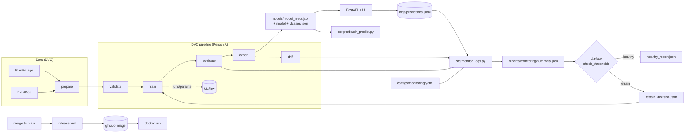

# Architecture

## Automation layers

| Layer | File | Trigger | Does |
|---|---|---|---|
| CI (A) | `.github/workflows/ci.yml` | push / PR | lint, tests, synthetic smoke test, Docker build |
| Delivery (B) | `.github/workflows/release.yml` | merge to `main` | build image, push to GHCR, smoke-test `/health` |
| Scheduled pipeline (B) | `airflow/dags/agroscan_pipeline.py` | weekly | validate, run pipeline, monitor logs, branch healthy / retrain |

## The serving contract

The API, batch script and notebooks all read `models/model_meta.json` (`img_size`, `input_range`, `center_crop`, `confidence_threshold`, `top_k`, ...). Change preprocessing only through that file and `src/preprocess.py`; never hard-code it elsewhere.
