# AgroScan architecture

The Mermaid graph below mirrors the stages and dependencies in `dvc.yaml`. The archive cleaning stage is a separate branch; it does not feed `prepare`. The v5 baseline evaluation runs alongside candidate evaluation, and both feed `export`.

```mermaid
flowchart LR
  subgraph dvc["DVC pipeline in dvc.yaml"]
    archive["data/agroscan_prepared_v1.zip"] --> clean["clean_prepared_archive<br/>src/clean_prepared_archive.py"]
    clean --> cleaned["data/agroscan_prepared_v1_clean.zip"]
    pv["data/plantvillage"] --> prep["prepare<br/>src/prepare_data.py"]
    pd["data/plantdoc"] --> prep
    prep --> prepared["data/prepared/"]
    prepared --> validate["validate<br/>src/validate_data.py"]
    validate --> validation["reports/data_validation.json"]
    prepared --> train["train<br/>src/train.py"]
    validation --> train
    train --> candidate["models/model.keras<br/>models/classes.json"]
    candidate --> evaluate["evaluate<br/>src/evaluate.py"]
    prepared --> evaluate
    evaluate --> metrics["reports/metrics.json<br/>classification_report.json<br/>confusion_matrix.png"]
    prepared --> evalv5["evaluate_v5_baseline<br/>src/evaluate_v5.py"]
    v5["models/model_meta.v5.json<br/>models/mobilenetv2.keras<br/>models/class_names.json"] --> evalv5
    evalv5 --> v5metrics["reports/v5_plantdoc_metrics.json"]
    candidate --> export["export<br/>src/export_model.py"]
    metrics --> export
    v5metrics --> export
    v5 --> export
    export --> servingmeta["models/model_meta.json"]
    servingmeta --> drift["drift<br/>src/drift_check.py"]
    prepared --> drift
    drift --> driftreport["reports/drift.json"]
  end

  train -. "params, metrics, model registration" .-> mlflow[("MLflow<br/>sqlite:///mlflow.db")]

  subgraph serving["Inference and monitoring"]
    servingmeta --> api["FastAPI<br/>api/main.py"]
    api --> ui["ui/index.html<br/>GET /ui/"]
    api --> predlog["logs/predictions.jsonl"]
    predlog --> monitor["src/monitor_logs.py<br/>configs/monitoring.yaml"]
    metrics --> monitor
    driftreport --> monitor
    monitor --> summary["reports/monitoring/summary.json"]
  end

  subgraph scheduled["Airflow: airflow/dags/agroscan_pipeline.py"]
    dag["Weekly agroscan_pipeline"] --> validate_task["validate_data"]
    validate_task --> repro["run_pipeline: dvc repro"]
    repro --> summarize["summarize_live_logs"]
    summarize --> branch{"check_thresholds"}
    branch --> healthy["healthy_report"]
    branch --> decision["retrain_decision"]
    decision --> train_task["train"] --> eval_task["evaluate"] --> export_task["export"]
  end
  summary -. "summary read by branch task" .-> branch

  subgraph delivery["GitHub Actions delivery"]
    ci[".github/workflows/ci.yml<br/>push / pull request to main"]
    release[".github/workflows/release.yml<br/>push to main / workflow_dispatch"]
    release --> ghcr[("GHCR: latest + short SHA")]
    ghcr --> image["Docker image<br/>port 8000"]
    compose["docker-compose.yml<br/>API :8000, MLflow :5000"]
  end
```

## Serving contract

`api/main.py` checks model metadata in this order: `models/model_meta.json`, then `models/model_meta.v5.json`; if neither exists, it falls back to `models/model.keras` and `models/classes.json`. Metadata selects the model file, class-name file, image size, input range, center-crop behavior, confidence threshold, and top-k count. The shared preprocessing code is `src/preprocess.py`.

The API routes are `/`, `/health`, `/ready`, `POST /predict`, and the static browser UI under `/ui/`. `/health` is liveness; `/ready` is the model-loaded check. The API appends summaries to `logs/predictions.jsonl`; `src.monitor_logs` reads that log and can also use `reports/metrics.json`, `reports/drift.json`, and `configs/monitoring.yaml`.

Offline drift in `src/drift_check.py` compares image brightness and channel means from prepared train and test samples. It does not read API logs. `src.monitor_logs.py` is the separate prediction-log monitor.

## Automation details

| Layer | Actual file | Trigger and action |
|---|---|---|
| Tests and image build | `.github/workflows/ci.yml` | Push or pull request to `main`; Ruff, pytest, Docker build; model pull and `/ready` smoke check only when `GDRIVE_CREDENTIALS_DATA` is set. |
| Image release | `.github/workflows/release.yml` | Push to `main` or manual `workflow_dispatch`; publishes `latest` and short-SHA tags to GHCR and checks `/health`. |
| Scheduled workflow | `airflow/dags/agroscan_pipeline.py` | Weekly `agroscan_pipeline`: validate, `dvc repro`, summarize logs, branch to healthy report or retrain decision and train/evaluate/export. |
| Local synthetic smoke | `Makefile` | `make smoke` runs synthetic pipeline data with `params.ci.yaml`. |
